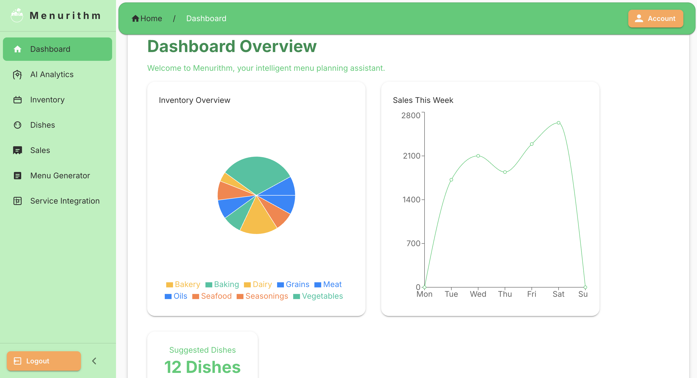

# Menurithm

Menurithm is a data-driven decision-support application designed to assist food service operators with inventory alignment, menu planning, and procurement insights.



## Overview

The public landing page includes a silent, 28-second product walkthrough
recorded with sample data. The MP4 and poster live in `frontend/public/demo/`;
update the on-page transcript when replacing the walkthrough.
Menurithm processes operational data such as inventory levels and historical usage to generate recommendations that support planning decisions in restaurant and food service environments.

## Key Capabilities
- Inventory-aware menu planning
- Historical usage and demand trend analysis
- Decision-support dashboards for operators
- Integration with external supply coordination systems (e.g., Croprithm)

## Pickup and farmer-delivery pilot

Open **Purchasing → Produce marketplace** to shop listings and track orders.
For a custom request, open **Orders & quotes** or use **Source produce** in
Inventory. These paths use the
same persistent quote workflow. Request customer pickup or farmer delivery with a preferred
window and handling requirements. Delivery requires an address; pickup does not.

In **Account settings → Restaurant profile**, save a contact name, restaurant name
and one delivery address. When requesting farmer delivery, select **Use saved
delivery address**, then review or edit the address for that request. Updating
the profile does not change sign-in credentials or previously placed orders.

The former Integrations page redirects to **Orders & quotes**. Account settings
also links there. Service-to-service dish creation remains available through
the API, not as a restaurant workspace page.

Use **Inventory → Low stock** to see ingredients at or below their reorder
point, and **Find produce** on a stock row to source that ingredient.
In **Dishes & recipes**, open a dish marked **Needs recipe review** to see
which batch or ingredient details to fix. Filter **Order activity** to see
orders separately from open quote requests.

A farmer quotes the fulfillment method they can offer, pickup address where
needed, handover instructions, a USD produce subtotal and delivery fee. Review the exact quote,
explicitly check the agreement box and accept it. Stale quote revisions are
rejected and require a refresh/review. Accepted terms are immutable.
Pickup has a zero delivery fee. **Pay the farmer directly; accepting terms
never charges a card.** Accepting a new quote reserves the listed stock;
canceling before handover releases it. Neither action updates kitchen stock.
Refresh orders to see farmer-confirmed ready/collected/delivered progress.

The server-only `FULFILLMENT_BRIDGE_KEY` must match the Croprithm API setting.
It is separate from legacy supplier API credentials and must never be exposed
as a frontend variable. Customer ownership comes from the authenticated
Menurithm user, not a browser-supplied customer ID. Missing configuration fails
with 503; upstream failures are explicit, without demo success.
The legacy `create-produce-order` endpoint now returns 409 directing clients to
the agreement workflow; existing historical order records are retained.

See [Croprithm deployment and migration instructions](https://github.com/brianmbeere/croprithm#backend-setup-and-deployment-order).

The **Produce marketplace** shows live listings in a visual grid. Select a
card or a cart item for variety, stock, farm location, any supplied harvest
and expiry dates, and the listing description. Farmers can choose the crop
illustration in Croprithm; otherwise it is matched automatically by produce
type. The illustrations are not farm photos. Open **Cart** to edit quantities
and review checkout without leaving the catalog.

The workspace includes a checkout preview for live
Croprithm listings. Add items from one farm, edit quantities, and review the
produce subtotal after Croprithm checks live price and stock. This does not
place an order, reserve inventory, or contact Stripe. Delivery windows, taxes,
and service fees are not calculated in the preview. Use **Orders & quotes**
for the existing pilot flow.

When the farm has posted pickup windows, select one and place the order at
the posted price without a quote or online charge. Pay the farmer at pickup.
Placing the order commits stock immediately. Review or cancel the whole order
before the farmer marks any item ready in **Orders & quotes**. Cart pickup
orders do not yet link their lines to kitchen inventory. See the [Croprithm
pickup instructions](https://github.com/brianmbeere/croprithm#pay-at-pickup-checkout).
Tests: from `backend`, run
`python -m pytest tests/test_fulfillment.py tests/test_croprithm_config.py tests/test_database_config.py -q`.
For a credential-free UI check, run Vite and open `/tests/fulfillment.html`.
This dev-only fixture uses fake orders, not production writes.

## Square POS sales import

Open **Sales → Square POS** (also linked from Account settings). Connect a Square
seller, select a location and up to seven days, and preview completed paid
orders. Match each Square item variation you want to import to a Menurithm dish.
Confirmation records the mapped sale lines and uses the existing recipe-based
inventory workflow. Reimporting the same Square order line will not deduct
stock again. This check does not recognize sales previously entered manually
or through CSV. Unmapped items are skipped and can be imported later.

This is an on-demand import, not a background sync. It uses USD base item
prices before discounts and tax; it skips refunds, returns, non-itemized
charges and measured quantities. Refunds after import must be handled in
Menurithm if a correction is needed. The connection cannot take payments.
Disconnecting deletes the credentials stored in Menurithm and preserves
imported sales; remove the app in Square to revoke the grant there.

Configure these on the **backend only**:

| Variable | Value |
|---|---|
| `SQUARE_ENVIRONMENT` | `sandbox` for a test deployment or `production` for a live deployment |
| `SQUARE_APPLICATION_ID` | Square application ID for the selected environment |
| `SQUARE_APPLICATION_SECRET` | Matching Square OAuth application secret |
| `SQUARE_REDIRECT_URI` | Exact OAuth redirect URL registered in Square, e.g. `https://menurithm.com/account` |
| `SQUARE_TOKEN_KEY` | Stable Fernet key; generate with `python -c 'from cryptography.fernet import Fernet; print(Fernet.generate_key().decode())'` |

Use Square Sandbox with a test workspace, not a live kitchen database.
The backend creates the three new tables on startup via its standard
metadata initialization; no existing records need to be rewritten. Keep
the token key stable across deploys. The app requests `ORDERS_READ` and
`MERCHANT_PROFILE_READ`. Validate a real OAuth round trip and a sample sale
in Sandbox before enabling production credentials.

Both apps now share a restrained green/neutral visual language with semantic
error/warning states, keyboard focus styles, 44px action targets, responsive
MUI grids and navigation. Menurithm's dashboard tabs follow URLs/deep links;
Dishes/Sales labels match their content. Landing and authentication screens
use clearer pilot-focused messaging. Physical-device and live-user usability
validation remains a separate pilot task.
Menurithm's primary green is `#03D069`, sampled from its logo. Dark green text
is used on this bright background instead of low-contrast white; darker
companion greens are reserved for readable text on white.

## Sale-driven inventory deductions

Manual sale entry and sales CSV uploads deduct recipe ingredients only when the
dish has an explicitly confirmed recipe yield. Existing recipes have no assumed
yield; save the dish with the number of servings its ingredient quantities make
before recording sales. Recipe quantities are converted only across supported
compatible units, and sales that cannot be safely processed remain visible with
a reason and do not deduct stock.

Sales created through the API should send a unique `Idempotency-Key` header and
reuse it when retrying the same request. Identical CSV uploads are recognized by
file content and row number. Corrections and cancellations create compensating
inventory movements; inventory history is available from the Inventory screen.

For an existing database, back it up and run
`python migrations/add_sales_inventory_automation.py` from `backend` before
deploying this version. The migration is additive and does not infer a yield
for existing recipes or backfill legacy recipe quantities into the new precise
quantity field. Existing sales are labeled as historical/unprocessed, not
deducted. Edit and save legacy recipes to confirm their quantities and serving
yield before processing new sales.

In **Dishes & recipes**, search by dish or ingredient, or use **Needs recipe
review** to find missing yields, unconfirmed quantities, and missing inventory
links. Enter recipe quantities for the whole batch and specify how many
servings it makes. The per-serving preview is approximate; the original batch
amounts are saved. CSV import remains available below the dish library.

Restaurant inventory items now support an optional reorder point. The Inventory
screen offers **All ingredients**, **At reorder point**, and **Out of stock**
views plus a storage-location filter. Choose **Count stock** to enter the total
on hand and record a reason. Open an ingredient to review its movement history
or edit its details. CSV import remains available below the stock list.
The screen flags stock at or below the threshold and can open a Croprithm listing
search for the ingredient. Selecting a listing opens a request; stock is
reserved when the restaurant accepts the farmer's new quote. When the farmer
marks handover complete, the restaurant can confirm the actual quantity received
to add one idempotent movement to recipe-linked kitchen inventory.
When an order is opened from a low-stock ingredient, the request preselects that
kitchen item and suggests enough produce to reach its reorder point. The
restaurant still reviews the request and confirms the actual quantity received.
After confirmation, a downloadable PDF receiving record is available from the
order. It documents the received quantity and resulting stock movement; it is
not a purchase invoice or proof of payment.

Deploy the additive Croprithm fulfillment migration with
`python migrate_fulfillment.py` from its `backend` directory before deploying
the connected Menurithm API. The older `inventory_enhanced` data model remains
separate and is read-only: its voice updates, enhanced inventory CSV import, and
legacy delivery receipt endpoints return HTTP 410, and the Inventory screen no
longer offers voice stock updates. This flow updates the recipe-linked
`inventory` table only and does not merge potentially conflicting records. Keep
using the recipe-linked Inventory screen for stock changes until an explicit,
reconciled migration is performed. Existing database records are preserved;
this feature does not drop or reseed database data.

## Architecture (High-Level)

### Croprithm integration naming

The supplier platform formerly called Routecast is now Croprithm:
[repository](https://github.com/brianmbeere/croprithm),
[frontend](https://croprithm.com).
Set `CROPRITHM_API_KEY` and `CROPRITHM_BASE_URL` on the backend only.
The live URL is `https://api.croprithm.com/api`, with DNS and HTTPS verified.
The compatibility URL is `https://routecast-core.onrender.com/api`.
The shared configuration falls back to legacy `ROUTECAST_API_KEY` and
`ROUTECAST_BASE_URL` when new variables are absent. New variables take precedence;
an explicitly empty new API key disables live integration rather than reviving
a legacy key. Empty base URLs fail explicitly.

The old `RouteCastIntegrationService` import remains an alias for
`CroprithmIntegrationService`. Existing `routecast_*` database columns and JSON
fields remain unchanged to preserve stored orders and client contracts.

The system follows a modular architecture with:
- Backend services that ingest and process operational data
- Structured relational data persistence
- Web-based user interfaces that present actionable insights

For per-service logical databases and bounded connection pools on a shared Render
Postgres instance, see the [database deployment guide](backend/app/db/README.md#sharing-a-render-postgres-instance).

### Cost-optimized Render deployment

#### Menurithm custom-domain rollout

The existing static site has `menurithm.com` attached, with
`www.menurithm.com` redirecting to the root. The existing API has
`api.menurithm.com` attached. No additional service is required.
Firebase authorized domains and backend CORS include both new website origins,
while retaining the working Render origins.

Configure these records in GoDaddy, preserving unrelated mail, verification,
nameserver and security records:

| Type | Name | Value |
| --- | --- | --- |
| A | @ | 216.24.57.1 |
| CNAME | www | menurithm.onrender.com |
| CNAME | api | menurithm-core.onrender.com |

DNS is verified for all three hosts, and website HTTPS and the www redirect work.
The API certificate and health endpoint are verified.
`VITE_BASE_URL=https://api.menurithm.com` selects the custom API in production
builds. Croprithm's integration uses the new hostname with its existing path
unchanged, and portfolio links use the new domains.
The website's primary address is now `https://menurithm.com`;
the assigned Render URLs remain available during this staged transition.
Render custom-domain quota charges can apply even though static compute is free.

The React frontend is a browser-only Vite SPA and needs no Node server in
production. [`render.yaml`](render.yaml) defines a free static site named
`menurithm`: root `frontend`, build `npm ci --include=dev && npm run build`,
publish `dist`, with `/*` rewritten to `/index.html` for client-side routing.
It deliberately does not provision another database or duplicate the backend.
Do not manage the same static site with both manual settings and a separate
Blueprint without first importing/reconciling the resource.

Copy the existing frontend's `VITE_*` variables as **build-time** settings,
including `VITE_BASE_URL=https://api.menurithm.com` and Firebase web
configuration. Rebuild after changing them. Production builds fail explicitly
if required API/Firebase settings are missing or the API URL is not HTTPS.
For a local production build, override a localhost development URL:

```bash
cd frontend
VITE_BASE_URL=https://api.menurithm.com npm run build
```

Everything prefixed `VITE_` is public in the browser bundle. Never include a
database URL, Firebase Admin credentials or service-to-service secrets. Firebase
web configuration is designed to be public.

Add the new site origin to the backend's **`CORS_ORIGINS`** (not
`ALLOWED_ORIGINS`, which Menurithm's main module does not use), retaining old
origins during staging. Add the new hostname to Firebase Authentication's
authorized domains and update any referrer restrictions on the Firebase web
API key. Verify sign-in, API requests and direct `/signin` and `/dashboard`
navigation before suspending the old paid frontend.

The static site uses `menurithm.onrender.com`, reclaimed after deleting the old
paid web service. The temporary `menurithm-static.onrender.com` staging URL is
retired. Use the clean URL in bookmarks and integration links.
Static sites have no always-on compute charge,
but workspace bandwidth and build-minute allowances still apply.

For the live consolidation, retain the existing `menurithm` logical database on
the smaller Menurithm instance and restore Croprithm into a separate `routecast`
database there. The `_pilot` names in the database guide are examples for a fresh
setup, not a requirement to rename or recopy Menurithm's existing data.
Both inspected instances use Basic 256 MB compute (not legacy $7 Starter);
Menurithm has 5 GB allocated storage and Croprithm 15 GB. Their live
`SHOW max_connections` value was 103, including PostgreSQL-reserved slots; keep
the much smaller application pool limits instead of treating that as a target.
The original Croprithm instance was retained during cutover verification, then
permanently deleted with user approval after backup checksums and both active
applications were verified.

#### Verified live layout (2026-10-18)

| Component | Deployment |
| --- | --- |
| Menurithm frontend | https://menurithm.com (menurithm.onrender.com compatibility hostname) |
| Croprithm frontend | https://croprithm.com (free static site; croprithm.onrender.com fallback) |
| Menurithm API | https://api.menurithm.com (menurithm-core.onrender.com compatibility hostname) |
| Croprithm API | https://api.croprithm.com (routecast-core.onrender.com compatibility hostname) |
| Active Postgres | `shared-pilot-postgres`, Basic 256 MB, 5 GB allocated |
| Shared infrastructure project | `Shared Infrastructure` / `Production` |
| Menurithm logical database | `menurithm`, existing owner login |
| Croprithm logical database | `routecast`, dedicated `routecast_api` login |
| Retired resources | Old paid frontends and original Croprithm Postgres permanently deleted |

Both APIs use pool size 2, overflow 1, timeout 30 seconds and recycle 1800
seconds. The sites deploy from their GitHub `main` branches; live Render static
settings match the checked-in Blueprint definitions. Editing a Blueprint file
alone does not attach an existing manually created service to Blueprint sync.

During cutover, both APIs were suspended and database application sessions
drained before PostgreSQL 16 custom-format backups were taken. All restored
Croprithm table counts/content digests and sequence values matched the source;
Menurithm's existing tables/content remained unchanged. Post-cutover,
database-backed reads and CORS preflights passed for both new origins, including
after suspending the original Croprithm instance.

The two deleted frontend Starter services remove approximately $14/month of
compute, and deleting the unused Basic 256 MB database removes approximately
$6/month more plus its allocated storage charges at current published rates.
No retired Render resources remain allocated.

The original clean frontend URLs now serve the free static sites. The temporary
`-static` staging sites are retired; they do not redirect.
The old Croprithm database and its Render-managed recovery history are deleted.
Private PostgreSQL 16 cutover dumps were retained and their checksums verified
before deletion; they are point-in-time copies, not replicas of subsequent writes.
Recovery into another instance requires provisioning a target and restoring a
backup. Pause writers and copy/reconcile current data rather than replacing
newer writes with a stale cutover dump.

#### Shared infrastructure ownership

The active instance was renamed from `menurithm` to
[`shared-pilot-postgres`](https://dashboard.render.com/d/dpg-d1b9okidbo4c73cal3o0-a)
and moved out of the Menurithm app project:

```text
Shared Infrastructure / Production
  shared-pilot-postgres
    menurithm  (logical database; existing owner login)
    routecast  (logical database; routecast_api login)
Menurithm / Production
  menurithm-core
  menurithm
Croprithm / Production
  routecast-core
  routecast
```

This is a Render resource/display-name and project-organization change, not
`ALTER DATABASE`: database names, roles, passwords, connection URLs, region,
storage and service URLs are unchanged. An existing hostname or default login
containing `menurithm` is expected; do not replace it with the new display name.
Keep `DB_NAME=menurithm` on this API and `DB_NAME=routecast` on Croprithm.

The two app projects remain independently GitHub-linked. Shared Infrastructure's
Production environment permits cross-environment private networking, matching
both app environments, so both same-region APIs can use the existing internal
database URLs. Enabling network isolation later requires reviewing both clients.
Database credentials stay service-specific; do not share DB_NAME or owner
credentials through a common environment group.

Neither app's static-site Blueprint declares the shared Postgres resource.
Do not add a database declaration to both repositories: that would duplicate
ownership or provision extra billable instances. If adopting Blueprint management
for shared infrastructure later, import the existing resource into one dedicated
infrastructure source of truth.

## Sample Interface
The screenshot above illustrates how planning insights are presented to users in a practical, operational format.

## Status
This repository contains an actively developed implementation of the Menurithm platform designed for real-world operational use and iterative refinement.

## Author
Brian Mbeere – Software Engineer  
Focus: data-driven decision-support systems and operational planning platforms.
