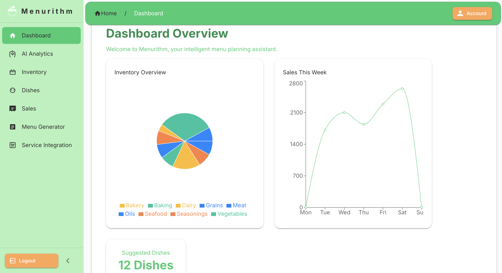

# Menurithm

Menurithm is a data-driven decision-support application designed to assist food service operators with inventory alignment, menu planning, and procurement insights.



## Overview
Menurithm processes operational data such as inventory levels and historical usage to generate recommendations that support planning decisions in restaurant and food service environments.

## Key Capabilities
- Inventory-aware menu planning
- Historical usage and demand trend analysis
- Decision-support dashboards for operators
- Integration with external supply coordination systems (e.g., Routecast)

## Architecture (High-Level)
The system follows a modular architecture with:
- Backend services that ingest and process operational data
- Structured relational data persistence
- Web-based user interfaces that present actionable insights

For per-service logical databases and bounded connection pools on a shared Render
Postgres instance, see the [database deployment guide](backend/app/db/README.md#sharing-a-render-postgres-instance).

### Cost-optimized Render deployment

The React frontend is a browser-only Vite SPA and needs no Node server in
production. [`render.yaml`](render.yaml) defines a free static site named
`menurithm-static`: root `frontend`, build `npm ci --include=dev && npm run build`,
publish `dist`, with `/*` rewritten to `/index.html` for client-side routing.
It deliberately does not provision another database or duplicate the backend.
Do not manage the same static site with both manual settings and a separate
Blueprint without first importing/reconciling the resource.

Copy the existing frontend's `VITE_*` variables as **build-time** settings,
including `VITE_BASE_URL=https://menurithm-core.onrender.com` and Firebase web
configuration. Rebuild after changing them. Production builds fail explicitly
if required API/Firebase settings are missing or the API URL is not HTTPS.
For a local production build, override a localhost development URL:

```bash
cd frontend
VITE_BASE_URL=https://menurithm-core.onrender.com npm run build
```

Everything prefixed `VITE_` is public in the browser bundle. Never include a
database URL, Firebase Admin credentials or service-to-service secrets. Firebase
web configuration is designed to be public.

Add the new site origin to the backend's **`CORS_ORIGINS`** (not
`ALLOWED_ORIGINS`, which Menurithm's main module does not use), retaining old
origins during staging. Add the new hostname to Firebase Authentication's
authorized domains and update any referrer restrictions on the Firebase web
API key. Verify sign-in, API requests and direct `/signin` and `/dashboard`
navigation before suspending the old paid frontend.

The old `menurithm.onrender.com` hostname belongs to the existing web service;
the replacement uses `menurithm-static.onrender.com`. Suspending the old service
does not redirect that hostname. Update bookmarks/integration links, or move a
custom domain to the new site. Static sites have no always-on compute charge,
but workspace bandwidth and build-minute allowances still apply.

For the live consolidation, retain the existing `menurithm` logical database on
the smaller Menurithm instance and restore Routecast into a separate `routecast`
database there. The `_pilot` names in the database guide are examples for a fresh
setup, not a requirement to rename or recopy Menurithm's existing data.
Both inspected instances use Basic 256 MB compute (not legacy $7 Starter);
Menurithm has 5 GB allocated storage and Routecast 15 GB. Their live
`SHOW max_connections` value was 103, including PostgreSQL-reserved slots; keep
the much smaller application pool limits instead of treating that as a target.
The original Routecast instance was retained during cutover verification, then
permanently deleted with user approval after backup checksums and both active
applications were verified.

#### Verified live layout (2026-10-18)

| Component | Deployment |
| --- | --- |
| Menurithm frontend | https://menurithm-static.onrender.com (static site) |
| Routecast frontend | https://routecast-static.onrender.com (static site) |
| Menurithm API | https://menurithm-core.onrender.com |
| Routecast API | https://routecast-core.onrender.com |
| Active Postgres | `shared-pilot-postgres`, Basic 256 MB, 5 GB allocated |
| Shared infrastructure project | `Shared Infrastructure` / `Production` |
| Menurithm logical database | `menurithm`, existing owner login |
| Routecast logical database | `routecast`, dedicated `routecast_api` login |
| Retired resources | Old paid frontends and original Routecast Postgres permanently deleted |

Both APIs use pool size 2, overflow 1, timeout 30 seconds and recycle 1800
seconds. The sites deploy from their GitHub `main` branches; live Render static
settings match the checked-in Blueprint definitions. Editing a Blueprint file
alone does not attach an existing manually created service to Blueprint sync.

During cutover, both APIs were suspended and database application sessions
drained before PostgreSQL 16 custom-format backups were taken. All restored
Routecast table counts/content digests and sequence values matched the source;
Menurithm's existing tables/content remained unchanged. Post-cutover,
database-backed reads and CORS preflights passed for both new origins, including
after suspending the original Routecast instance.

The two deleted frontend Starter services remove approximately $14/month of
compute, and deleting the unused Basic 256 MB database removes approximately
$6/month more plus its allocated storage charges at current published rates.
No retired Render resources remain allocated.

The old frontend `onrender.com` URLs are now unavailable, not redirected.
The old Routecast database and its Render-managed recovery history are deleted.
Private PostgreSQL 16 cutover dumps were retained and their checksums verified
before deletion; they are point-in-time copies, not replicas of subsequent writes.
Recovery into another instance requires provisioning a target and restoring a
backup. Pause writers and copy/reconcile current data rather than replacing
newer writes with a stale cutover dump.

#### Shared infrastructure ownership

The active instance was renamed from `menurithm` to
[`shared-pilot-postgres`](https://dashboard.render.com/d/dpg-d1b9okidbo4c73cal3o0-a)
and moved out of the Menurithm app project:

```text
Shared Infrastructure / Production
  shared-pilot-postgres
    menurithm  (logical database; existing owner login)
    routecast  (logical database; routecast_api login)
Menurithm / Production
  menurithm-core
  menurithm-static
Routecast / Production
  routecast-core
  routecast-static
```

This is a Render resource/display-name and project-organization change, not
`ALTER DATABASE`: database names, roles, passwords, connection URLs, region,
storage and service URLs are unchanged. An existing hostname or default login
containing `menurithm` is expected; do not replace it with the new display name.
Keep `DB_NAME=menurithm` on this API and `DB_NAME=routecast` on Routecast.

The two app projects remain independently GitHub-linked. Shared Infrastructure's
Production environment permits cross-environment private networking, matching
both app environments, so both same-region APIs can use the existing internal
database URLs. Enabling network isolation later requires reviewing both clients.
Database credentials stay service-specific; do not share DB_NAME or owner
credentials through a common environment group.

Neither app's static-site Blueprint declares the shared Postgres resource.
Do not add a database declaration to both repositories: that would duplicate
ownership or provision extra billable instances. If adopting Blueprint management
for shared infrastructure later, import the existing resource into one dedicated
infrastructure source of truth.

## Sample Interface
The screenshot above illustrates how planning insights are presented to users in a practical, operational format.

## Status
This repository contains an actively developed implementation of the Menurithm platform designed for real-world operational use and iterative refinement.

## Author
Brian Mbeere – Software Engineer  
Focus: data-driven decision-support systems and operational planning platforms.
